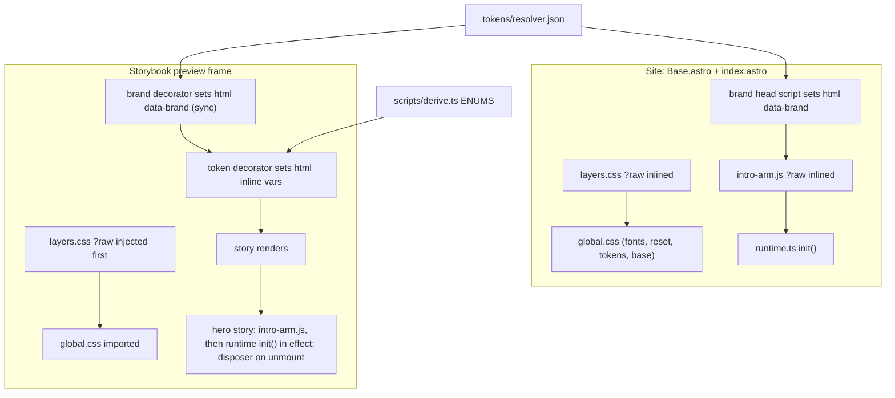
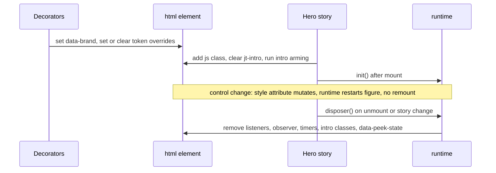

# Storybook Brand Workshop - Plan

## Goal Capsule

- **Objective:** a hiring manager, product leader or engineer can open the site's component library, switch brands from one dropdown, flip each component's token-driven configuration live, and see that the markup never changes. This is the ELC multi-brand Storybook, at portfolio scale.
- **Means:** Storybook 10 over the existing React components, with a synchronous brand toolbar and a token-control layer that writes CSS custom properties (KTD2, KTD3).
- **Product authority:** Jarod. This plan covers Storybook only. Figma is a separate, later brainstorm and is not active scope.
- **Stop conditions:** stop and ask if the hero runtime refactor (U1) changes anything a visitor sees on the live home page, or if a token control can only work by changing component markup or props.
- **Execution profile:** one feature branch, one PR, the `docs/WORKFLOW.md` loop (design review applies to the hero story only if U1 changes visible output, per the Verification Contract). Jarod pushes and merges.
- **Open blockers:** none.

---

## Product Contract

Product Contract preservation: clarified, no scope change. AE3 now names backstage and blocks, because `clean` has no intro by design (`hero-intro: none`). R7's CI enforcement is scoped to "a story exists"; whether a changed component's story was updated stays a review call (KTD7). The "PR screenshots" Key Decision now says Storybook is outside the screenshot checks, not outside the PR gate, matching R8.

### Summary

A Storybook of the site's real components with a brand dropdown and, per story, live controls for the layout tokens that component reads. It is built first in Phase 1 step 5, grows one story per component from then on, and goes public at the v0 launch, linked from the Colophon.

### Problem Frame

The site claims design-system leadership, but nothing on it lets a visitor see the system. At ELC, Jarod's team built a Storybook where one component library rendered as MAC or Jo Malone from a dropdown, with each component visibly configurable; that demo landed with hiring managers, product leaders and engineers alike. The pipeline named in `docs/PLAN.md` (Figma → tokens → Storybook → site) has its token stage live, but no Storybook and no Figma. The 2026-10-13 sequencing put both last, after Remix v1, so the proof would arrive only after the content it's meant to frame.

### Key Decisions

- **Showcase first, built incrementally.** The pipeline is both a working tool and proof, but proof has priority; it is backfilled in steady small steps, never one big push. (session-settled: user-directed — chosen over "working tool first" and "both equally": the visible demo matters most, and periodic backfill is acceptable.) Governs R7, R8.
- **This plan owns Storybook; Figma is split out.** (session-settled: user-approved — chosen over one combined pipeline brainstorm: Storybook is cheap and showcase-visible now, while Figma's cost is staying in sync during design churn.)
- **Layout configuration is shown as live token controls, not component props.** (session-settled: user-approved — chosen over brand-dropdown-only and ELC-style props: props would break the rule that brands differ only through tokens.) Governs R3, R4.
- **Build now, public at v0.** (session-settled: user-approved — chosen over public-now, start of Phase 2, and the original Phase 4: Phase 2 components then ship with stories from day one, and the public link waits for the Colophon.) Governs R7, R9.
- **Hero is in scope, as a page assembly.** The hero is the demo's best moment, and its motion and Peek overlay depend on the header, the hero and page-level state, so it can't be an isolated story. Governs R5.
- **PR screenshots stay on the real pages.** Playwright already loads every page in every brand; Storybook is not a dependency of the screenshot checks. Its build and story tests are PR gates in their own right (R8).
- **Supersedes the 2026-10-13 phase order** for Storybook only (`docs/DECISIONS.md`); Figma stays in Phase 4 until its own brainstorm.

### Requirements

**Brand switching**

- R1. A brand dropdown in the Storybook toolbar switches every story between `clean`, `backstage` and `blocks`, with `clean` as the default.
- R2. A component renders in Storybook exactly as on the site for the selected brand: same tokens, same layer order, same fonts.

**Token controls**

- R3. Each story exposes controls for the token-driven layout and decoration choices its component reads, so a viewer can flip them live.
- R4. Flipping a control changes only token values; the rendered markup is identical before and after.

**Coverage**

- R5. Every existing component has a story, including a hero story that assembles the header, hero and their motion so the intro and Peek work as they do on the site.
- R6. Simple components (for example Button and Card) also show their content options (text, link or no link) as ordinary controls.

**Ongoing growth**

- R7. Every new or changed component ships with its story in the same PR, enforced by CI.
- R8. Storybook builds in CI on every PR, so a broken story fails the PR.

**Publishing**

- R9. Storybook stays unpublished until the v0 launch, then is public and linked from the Colophon.

### Acceptance Examples

- AE1. **Covers R1, R2.** Given the Button story under `clean`, when the viewer picks `blocks`, then the button takes blocks' colours, radius and type, matching `/lab?brand=blocks`.
- AE2. **Covers R3, R4.** Given the hero story, when the viewer flips the hero layout control from one value to the other, then the layout changes and the DOM is unchanged.
- AE3. **Covers R5.** Given the hero story under `backstage` or `blocks`, when it loads, then the intro plays and the Peek toggle works as on the home page.
- AE4. **Covers R7.** Given a PR that adds a component without a story, then CI fails and names the component.

### Scope Boundaries

- **Figma.** Gets its own brainstorm. The Figma-ready export and the one-time T6 round trip go on the to-do list.
- **The visitor-facing Remix panel** (Phase 3, Q4). Storybook's token controls are the engineer-facing version of the same idea; the panel may reuse what this work learns but is not built here.
- **A brand that is configured differently, not just re-tokened.** A possible later demo. This work must not preclude it, but does not build for it.
- **Visual regression in Storybook.** Screenshots come from Playwright on the real pages.
- **Rich documentation pages** (token galleries, written guidelines) beyond what the stories themselves show. Storybook Docs/autodocs is off for now (KTD6).

**Considered and not built**

- **Showing each brand's resolved value inside the control.** Controls show "brand default" rather than the computed value; the rendered component already shows it. Revisit if viewers find the default ambiguous.
- **Resetting controls on brand switch.** A set control persisting across brands is the comparison the demo wants (KTD3).
- **Fixing the Header's `/` and `/lab/` links inside Storybook.** Clicking them navigates the preview away; harmless in a workshop.
- **A separate "Replay intro" control.** Changing the intro control already replays it (KTD5); reloading or switching story also does.
- **Reporting stale entries in the story covered-by map.** The map has one entry; a stale one hides no missing story.

#### Deferred to Follow-Up Work

- Public deploy of Storybook (R9): a later v0-launch unit decides the path (a `/storybook/` subpath under the site's `dist/` is the natural fit, since fonts load from root-absolute `/fonts/` URLs) and the Colophon link.

### Dependencies / Assumptions

- Storybook 10.6.x supports the repo's stack: React 19, Vite 8.3 (peer range `^5 || ^6 || ^7 || ^8`), Node 24, TS 6 with `moduleResolution: bundler` and `jsx: react-jsx`.
- The Colophon page exists by v0 (Phase 2 scope).

### Sources / Research

- `docs/PLAN.md` Stack table (Storybook 10) and Phase 4 (deploy target, Colophon link).
- `docs/DECISIONS.md` 2026-10-13 phase order; Q14.
- `src/layouts/Base.astro` (layer order inlined via `?raw`, brand script on `<html>`), `src/styles/global.css` (CSS chain), `src/styles/fonts.css` (root-absolute `/fonts/` URLs).
- `src/components/Hero/runtime.ts` (vanilla DOM, module side effects, `MutationObserver` on `data-brand`), `src/pages/index.astro` (pre-paint intro arming inline script; runtime import).
- `scripts/derive.ts` `ENUMS` (allowed values for every token enum; no imports, so Vite can load it).
- `scripts/check-contrast.ts` + `scripts/contrast.ts` + `scripts/contrast.test.ts` (check-script pattern).
- Storybook docs: Vitest addon (https://storybook.js.org/docs/writing-tests/integrations/vitest-addon), CLI options (https://storybook.js.org/docs/api/cli-options), toolbars and globals (https://storybook.js.org/docs/essentials/toolbars-and-globals).

---

## Planning Contract

### Key Technical Decisions

- KTD1. **Storybook 10.6.x with `@storybook/react-vite`, every `@storybook/*` package on the same version.** Plain React components need no Astro integration; the repo has no custom Vite config to mirror. Use the CLI-installed versions, not v11 prereleases.
- KTD2. **Own brand toolbar (`globalTypes` + a decorator that sets `data-brand` synchronously), not `@storybook/addon-themes`.** The addon sets the attribute in a `useEffect`, after the first render, so the hero runtime would start under the wrong brand and AE3 would fail. The brand list comes from `tokens/resolver.json`, the same source Base.astro uses. This departs from `docs/PLAN.md`'s Stack table; log it in `docs/DECISIONS.md`. Governs R1.
- KTD3. **Token controls are tri-state and write inline custom properties on `<html>`.** Each control's options are "brand default" plus the `ENUMS` values. "Brand default" writes nothing; any other value sets the exact leaf property the CSS reads (for example `--hero-layout`, not `--choice-hero-layout`) on `document.documentElement`, where `runtime.ts` and the `:root[...]` selectors also see it. A set value persists across brand switches, so viewers can compare brands under one configuration. Overrides are cleared when the story changes. Governs R3, R4. (session-settled: user-approved — chosen over resetting overrides on brand switch: comparing brands under one layout is the demo.)
- KTD4. **A hand-written map from `ENUMS` key to CSS property, guarded by a test.** No machine-readable map exists (`decoration` → `--section-decoration`, `label-case` → `--header-control-label-case`, …). The test fails when an `ENUMS` key has no mapping, or a mapped property is missing from `src/styles/tokens.css` (where it is declared) or from every component CSS file (where it is read).
- KTD5. **`runtime.ts` exports `init()` returning an idempotent disposer, and restarts its figure when `<html>`'s `style` changes as well as `data-brand`.** CSS-only enums then apply live with no remount (R4 stays testable), and runtime-read enums (`hero-figure`, `hero-ground`) restart through the existing brand-change path. `hero-intro` is the one control that remounts the hero story, because the intro is armed before first paint; the remount replays the chosen intro. The intro-arming script moves to one export-free plain-JS file that `index.astro` inlines via `?raw` + `set:html`, the same pattern Base.astro uses for `layers.css`. The hero story imports the same `?raw` text and executes it as a fresh `<script>` on every mount, never as a module import, which would run only once. (session-settled: user-approved — touches shipped site code, accepted in the scoping synthesis.)
- KTD6. **Canvas only; Docs/autodocs off.** Docs mode renders several stories in one document, so `<html>` overrides and two hero runtimes would collide.
- KTD7. **CI story coverage is per component directory.** `src/components/<Name>/` needs `<Name>.stories.tsx` with at least one named story export; an explicit covered-by map handles directories shown inside another story (`Peek` → `Hero`). The check proves a story exists, not that it was updated.
- KTD8. **Story tests run with `@storybook/addon-vitest` in browser mode (Playwright Chromium).** `storybook build` alone doesn't execute stories, and jsdom can't run the hero's canvas or style queries. CI already installs Chromium. The existing unit tests move into their own Vitest project so the two don't share environment settings.
- KTD9. **Layer order is injected from `src/styles/layers.css?raw` at the top of the preview, before any component CSS.** One source of truth, the same file Base.astro inlines; no hand-copied `@layer` line. Storybook builds to `storybook-static/` (gitignored), outside `dist/`, so the existing axe, invariance and Lighthouse checks never see it.

### High-Level Technical Design

How the preview frame mirrors what Base.astro and `index.astro` supply on the site:

Hero story lifecycle, the one ordering that matters (directional):

### Sequencing

U1 first (site-side refactor, verified on the real home page before any Storybook exists). U2 → U3 → U4 → U5 → U6.

---

## Implementation Units

### U1. Hero runtime start/stop and shared intro arming

- **Goal:** the hero runtime can be started, stopped and restarted on a page, with no visible change on the live site.
- **Requirements:** R5, AE3; KTD5.
- **Dependencies:** none.
- **Files:**
  - `src/components/Hero/runtime.ts` (modify)
  - `src/components/Hero/intro-arm.js` (new; the plain-JS body of today's inline script)
  - `src/pages/index.astro` (modify: inline `intro-arm.js?raw`, call `init()`)
  - `tests/hero-runtime.e2e.ts` (new)
  - `package.json` (`check:hero-runtime` = `playwright test hero-runtime`, added to `check` after `check:a11y`)
  - `.github/workflows/ci.yml` (a `check:hero-runtime` step after `check:a11y`)
- **Approach:**
  1. Move every module-level side effect in `runtime.ts` into `init()`, including the DOM queries (`[data-peek-toggle]` and the rest are looked up inside `init`).
  2. The disposer removes window/document listeners, disconnects the observer, calls `stopFigure()`, clears every timer (including the font-race timer), ignores a late `fonts.ready` callback, and removes `intro`/`building`/`settling`, `data-peek-state` and `aria-pressed` changes. Calling it twice is safe.
  3. The `<html>` observer watches `style` as well as `data-brand`, re-reading `--hero-figure` and `--hero-ground` and restarting only when they changed.
  4. Move the inline script body into `intro-arm.js` (no `export`). Its 4 s failsafe timer is stored on a known global, and arming clears any previous one first, so a re-arm within 4 s isn't cancelled by the old failsafe.
  5. Replace the inline script body in `index.astro` with the `?raw` inline of `intro-arm.js`; keep its comment.
- **Patterns to follow:** `src/layouts/Base.astro` `layers.css?raw` + `set:html` inline; existing `try {} catch {}` around `sessionStorage` in the inline script.
- **Test scenarios:**
  - Covers AE3. Home page with `?brand=backstage&intro`: the intro plays, then the page settles with no `intro` class left on `<html>`.
  - Home page under `clean`: no intro, and the Peek toggle opens and closes Peek.
  - Home page under reduced motion (`emulateMedia`): no intro classes are ever added; Peek still works.
  - Changing `<html>` inline `--hero-figure` from the test switches the running figure with no page reload.
  - Running the arming script twice within 4 s under backstage: the intro from the second arming still plays.
- **Verification:** `check:hero-runtime` passes locally and in CI; `check:markup-invariance` and `check:a11y` still pass; the home page looks and moves as before in all three brands.

### U2. Storybook scaffold and brand toolbar

- **Goal:** Storybook runs and builds in this repo, and any story renders as on the site for the selected brand.
- **Requirements:** R1, R2, R8 (build half); KTD1, KTD2, KTD6, KTD9.
- **Dependencies:** none (U1 not needed until U4).
- **Files:**
  - `.storybook/main.ts`, `.storybook/preview.ts`, `.storybook/brand.ts` (new)
  - `package.json` (devDependencies; `storybook` and `build-storybook` scripts that run `pnpm tokens` first)
  - `.gitignore` (`storybook-static/`)
  - `pnpm-workspace.yaml` (only if the release-age policy blocks the new packages)
- **Approach:**
  1. Install with the official CLI for React + Vite; pin all `@storybook/*` packages to one 10.6.x version.
  2. `main.ts`: stories glob `src/components/**/*.stories.tsx`, `staticDirs` serving `public/` at `/`, docs/autodocs disabled.
  3. `preview.ts`: inject `layers.css?raw` as the first `<style>` in `<head>`, then import `src/styles/global.css`; default `layout: 'fullscreen'`; a `storySort` that opens on the hero ("Page" group first, then "Components", Header first).
  4. `brand.ts`: a `brand` global with toolbar items from `tokens/resolver.json`, default from its `default`; a decorator that sets `document.documentElement.dataset.brand` before the story renders.
  5. A scrub of `<html>` (inline style, `js`, intro classes, `data-peek-state`) that runs when the story changes, so a crashed story can't leak into the next. It must not run on an args or brand change, or it would wipe overrides that KTD3 keeps across brand switches; tie it to the story id, not to every render.
- **Execution note:** mostly config; prove it with a running Storybook and a `build-storybook` run, not unit tests.
- **Patterns to follow:** `scripts/brands.ts` for the resolver shape.
- **Test scenarios:** Test expectation: none -- scaffolding; U5's story tests exercise the toolbar and rendering.
- **Verification:** `build-storybook` produces `storybook-static/` from a fresh checkout; switching the toolbar changes `data-brand` on the preview's `<html>` with no flash of `clean`.

### U3. Token-control layer

- **Goal:** any story can declare which token enums it reads and get tri-state controls that override them live.
- **Requirements:** R3, R4; KTD3, KTD4.
- **Dependencies:** U2.
- **Files:**
  - `.storybook/token-controls.ts` (new: the `ENUMS` key → CSS property map, an argTypes builder, the decorator)
  - `.storybook/token-controls.test.ts` (new)
  - `.storybook/preview.ts` (register the decorator)
  - `package.json` (`test` runs `pnpm tokens` first, like `dev` and `build`, because the map test reads the gitignored `src/styles/tokens.css`)
- **Approach:**
  1. Import `ENUMS` from `scripts/derive.ts`; map each of its 12 keys to the leaf property the CSS reads (e.g. `hero-layout` → `--hero-layout`, `decoration` → `--section-decoration`, `font-smoothing` → `--choice-font-smoothing`). U4 binds all 12 to controls.
  2. A story opts in by listing enum keys; the builder returns argTypes (radio or select, "brand default" first, category "Tokens").
  3. The decorator applies set values as inline properties on `<html>` and removes the ones set back to "brand default"; it clears everything when the story changes (not on a brand change).
  4. Token args never reach component props.
- **Patterns to follow:** `scripts/contrast.ts` / `contrast.test.ts` split (pure module + Vitest test).
- **Test scenarios:**
  - Every `ENUMS` key has a mapping; adding a key without one fails the test with its name.
  - Every mapped property appears in `src/styles/tokens.css` and in at least one `src/components/**/*.css` file.
  - The argTypes builder puts "brand default" first and lists exactly the `ENUMS` values for that key.
  - Applying args `{hero-layout: 'stack'}` then `{hero-layout: brand default}` leaves `<html>` with no inline `--hero-layout`.
- **Verification:** the tests pass; flipping a control in a running Storybook changes the rendered layout immediately.

### U4. Component stories

- **Goal:** every component has a story; the hero story shows the full page assembly with motion and Peek.
- **Requirements:** R2, R3, R5, R6, AE1, AE2, AE3.
- **Dependencies:** U1, U3.
- **Files (new, one per component directory):**
  - `src/components/Button/Button.stories.tsx` (text, link or button)
  - `src/components/Card/Card.stories.tsx` (title, body)
  - `src/components/SectionShell/SectionShell.stories.tsx` (title, surface, level; `decoration` control)
  - `src/components/Stage/Stage.stories.tsx` (`font-smoothing` control)
  - `src/components/InfoStrip/InfoStrip.stories.tsx` (`info-align` control)
  - `src/components/Header/Header.stories.tsx` (`label-case`, `nav-align`, `menu-shape`; a phone-viewport story, since `menu-shape` applies only there)
  - `src/components/Hero/Hero.stories.tsx` (the assembly; `hero-figure`, `hero-layout`, `hero-intro`, `hero-cue`, `hero-ground`, `link-underline` controls; changing `hero-intro` remounts the story so the chosen intro plays, per KTD5)
- **Approach:**
  1. Wrap isolated stories in `Stage` so stage-level tokens (font smoothing, height) apply.
  2. The hero story renders Stage, PeekColumns, Header, InfoStrip, `main` with Hero, and SkipIntro, in the same order as `index.astro`.
  3. On every mount it adds `js` to `<html>`, clears `jt-intro`, executes the `intro-arm.js?raw` text as a fresh `<script>`, then calls `init()` in an effect whose cleanup is the disposer (KTD5).
  4. Story titles group the hero as "Page" and the rest as "Components", matching U2's `storySort`.
  5. No component props are added for layout (Product Key Decisions; R4).
- **Patterns to follow:** `src/pages/index.astro` composition; `src/pages/lab.astro` for Button usage.
- **Test scenarios:** covered by U5's story tests, which run every story here.
- **Verification:** every story renders in all three brands without console errors; the hero story under backstage plays its intro and Peek toggles.

### U5. Story tests in a real browser

- **Goal:** a story that throws, or that breaks the brand and token behaviour, fails CI.
- **Requirements:** R8, AE1, AE2, AE3; KTD8.
- **Dependencies:** U4.
- **Files:**
  - `vitest.config.ts` (new or modified: a `unit` project for existing `*.test.ts`, a `storybook` project from the addon)
  - `.storybook/vitest.setup.ts` (new, as the addon generates)
  - `package.json` (`test` keeps unit tests; new `test:stories`)
  - `.storybook/workshop.test.tsx` (new, in the browser project: behaviour that spans re-renders)
  - `play` functions inside the story files from U4, for single-render assertions
- **Approach:**
  1. Add `@storybook/addon-vitest` with the CLI; keep the unit-test project's settings separate (KTD8).
  2. Every story becomes a render test automatically (the "every story renders" half of R8).
  3. A `play` function can't change a toolbar global or a control, and each story file runs in its own frame. So scenarios that flip args or the brand, or move between stories, live in `workshop.test.tsx`: portable stories (`composeStories` with the preview annotations) mounted with React, then re-rendered with changed args or `brand` global, or unmounted and followed by another story in the same document. Confirm the portable-stories way to pass globals at implementation time.
- **Test scenarios:**
  - Covers AE1. Button under `clean`, re-rendered with `brand` = `blocks`: computed background and border radius change; markup is identical.
  - Covers AE2. Hero: snapshot the hero's `outerHTML`, re-render with `hero-layout` flipped, compare after stripping what the runtime writes (`[data-readout]` text, `data-spec`/`data-tpl`, canvas `width`/`height`), the same exclusions `tests/markup-invariance.e2e.ts` uses: identical, and a layout-specific computed style changed.
  - Covers AE3. Hero under `backstage` and under `blocks`: `<html>` gets the `intro` class, then settles; clicking the Peek toggle sets `data-peek-state`.
  - Hero with `matchMedia` stubbed to reduced motion before mount: no intro classes are added.
  - Hero mounted, unmounted, then Button mounted in the same document: no `data-peek-state`, intro classes or inline token properties remain on `<html>`.
  - Hero with a `hero-figure` override, re-rendered with a different `brand` global: the override is still on `<html>` (KTD3).
- **Verification:** `test:stories` passes locally and in CI; deliberately throwing inside a story makes it fail.

### U6. CI wiring and story-coverage check

- **Goal:** CI builds Storybook, runs the story tests, and fails when a component directory has no story.
- **Requirements:** R7, R8, AE4; KTD7.
- **Dependencies:** U2 (build); U5 (tests); U4 (so the check passes on landing).
- **Files:**
  - `scripts/stories.ts`, `scripts/stories.test.ts`, `scripts/check-stories.ts` (new)
  - `package.json` (`check:stories`; add it, `build-storybook` and `test:stories` to `check`)
  - `.github/workflows/ci.yml` (steps: `check:stories` with the static checks; `build-storybook` and `test:stories` after `pnpm build` and the Chromium install)
- **Approach:**
  1. `stories.ts` lists `src/components/*/` directories, applies the covered-by map, and reports each directory whose `<Name>.stories.tsx` is missing or has no named story export.
  2. `check-stories.ts` prints `✖` lines naming the component and the expected file path, and exits 1 with a fix hint.
  3. Keep `package.json` `check` and `ci.yml` in step, as today.
- **Patterns to follow:** `scripts/check-contrast.ts` (header comment, `✖`/`✓`, exit codes, fix hint) and `scripts/contrast.ts` + `.test.ts`.
- **Test scenarios:**
  - Covers AE4. A fixture with `src/components/Foo/Foo.tsx` and no story: reported, naming `Foo` and `src/components/Foo/Foo.stories.tsx`.
  - A story file with no named export is reported.
  - `Peek` with no story file is not reported while the covered-by map lists it under `Hero`.
  - The current repo passes.
- **Verification:** `pnpm check` and CI run all three new steps green; removing a story file makes `check:stories` fail with the component's name.

---

## Verification Contract

| Gate | Command | Proves |
|---|---|---|
| Unit tests | `pnpm test` | `ENUMS` map (U3), story-coverage logic (U6), existing derive/contrast tests |
| Types | `pnpm typecheck` | stories and runtime refactor typecheck under `astro check` |
| Site behaviour | `pnpm build && pnpm check:markup-invariance && pnpm check:a11y && pnpm check:hero-runtime` | U1 changed nothing visible; runtime start/stop works on the real page |
| Story coverage | `pnpm check:stories` | R7, AE4 |
| Storybook build | `pnpm build-storybook` | R8 build half; output lands in `storybook-static/`, not `dist/` |
| Story tests | `pnpm test:stories` | R8 render half; AE1–AE3; reduced motion; teardown |
| Full chain | `pnpm test && pnpm typecheck && pnpm check` | everything, as CI runs it |

Design review per `docs/WORKFLOW.md` step 3 applies to the hero story only if U1 changes anything visible (it shouldn't).

---

## Definition of Done

- All Verification Contract gates pass locally and in CI.
- Every directory in `src/components/` has a story (or a covered-by entry), and every story renders in all three brands.
- In a running Storybook: the brand toolbar switches all stories; each story's token controls flip its layout live with unchanged markup; the hero story under backstage plays the intro and Peek works.
- The live home page looks and behaves as before in all three brands.
- `docs/WORKFLOW.md` step 2 notes that a component change ships with its story (KTD2 and KTD7 are already logged in `docs/DECISIONS.md`).
- No experimental or abandoned code from spikes is left in the diff.
